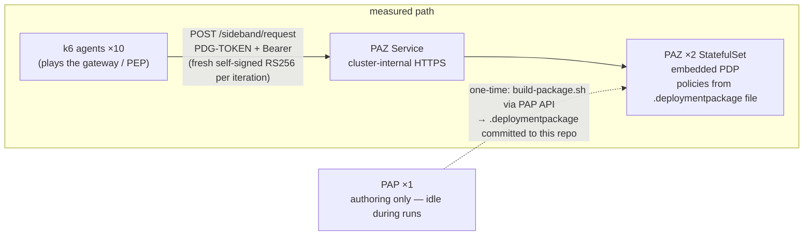

# PAZ sideband decision-path performance test

This project measures the performance of PingAuthorize Server (PAZ) acting as
the Policy Decision Point behind an API gateway, in Kubernetes. The load
generator plays the gateway's role (the Policy Enforcement Point): k6 agent
pods build the Sideband API request envelope exactly as a gateway integration
does and POST it to PAZ's `/sideband/request`, one authorization decision per
call. The campaign reports decision latency (p50/p90/p95/p99/max), achieved
throughput, error rate, and PAZ pod CPU/memory at fixed reference load levels
of 100, 250, and 500 decisions per second.

The deployment under test runs PAZ in **deployment-package (embedded PDP)
mode**: the policy state from a specific, versioned commit is exported as an
immutable bundle and loaded into the PAZ process itself. This is the
production integration model, and it differs from the sibling project
`ai-mcp-gateways-paz-integrations`, whose PAZ resolved policies through PAP
on every decision (external PDP mode). In this stack PAP exists only to build
the package once and sits off the decision path entirely. The full design —
including goals, non-goals, and the campaign protocol — is
[the spec](docs/superpowers/specs/2026-11-10-paz-sideband-perf-design.md).

## Architecture



What is deliberately absent: no JWKS server, no API gateway, no adapter, no
Ingress or cert-manager, no deployment-package store or polling. Token
validation uses PAZ's local trusted-certificate model — the k6-signed
tokens' public certificate ships in the PAZ server profile, so no remote
fetch, cache, or key-rotation behavior exists on the measured path. The
policies are the sibling project's `AgentGatewayPortfolioMCP` branch,
packaged as-is, so the measured decisions exercise the real policy ladder
(audience gate, agent-identity delegation, VIP check, scope check) rather
than a permit-all stub.

## Scope of this campaign

The campaign is a **baseline characterization** of the sideband decision path
in deployment-package mode at fixed reference levels up to **500
decisions/second**. It shares the PF campaign's scope discipline, and the
results support no conclusions about: the saturation point or maximum
sustainable throughput (no level is run to failure — the cluster is shared
with workloads this project does not own, so 500/s is the campaign bound);
behavior above 500/s; overload, burst, failure, or recovery behavior;
autoscaling (the PAZ topology is fixed at two pods); or a comparison against
external-PDP mode (this campaign measures deployment-package mode only).

## Measurement protocol

The protocol follows the PF campaign's (`pingfederate-token-exchange-perf`),
verbatim in its essentials:

- Each reference level is run **three times per campaign**, in ascending
  rounds (100 → 250 → 500, repeated three times). The reference table
  reports the **median run** of the three, selected by measured p95, with the
  per-run p95s quoted alongside it.
- A run counts only if it passes the generator-health gates: zero dropped
  iterations, achieved rate ≥ 98% of target, success rate ≥ 99%. A run that
  fails a gate is rerun and both attempts are recorded, never swapped or
  averaged in.
- The first run after a fresh deployment is discarded: one throwaway sanity
  run warms the PAZ pods before the campaign's first counted round.
- Every latency column comes from the **same measured window** — all raw
  datapoints of the measured scenario, pooled across all ten agents, warmup
  excluded — recorded per run in `results/<run_id>/summary.json`
  (`pooled_latency`) and rendered in the per-run report.
- Each run: 30 s warmup scenario (tagged, excluded from thresholds) followed
  by a 5-minute measured window at constant arrival rate, ten parallel k6
  agent pods each driving RATE/10.
- Server-side ground truth: an end-of-run scrape of PAZ's `cn=Monitor` Gateway
  Timing providers (best-effort — a scrape failure never invalidates a run)
  and a 5-second-cadence pod/node CPU CSV from `scripts/monitor.sh` running
  for the whole campaign.

## Repository layout

```
helm/paz/            Values for the official ping-devops chart (0.15.0, image
                     tag 2607): 1 PAP + 2 PAZ StatefulSets, ephemeral /opt/out,
                     lab sizing (PAZ requests 2 CPU/3Gi, limits 4/6Gi).
helm/loadtest/       The k6 agent chart: an indexed Job, N parallel agent pods,
                     each running files/sideband-decision.js with files/envelope.mjs.
server-profiles/     The PAZ dsconfig layer (trusted-certificate validator,
                     embedded-PDP Policy Decision Service, sideband endpoint)
                     and the PAP profile (snapshot import hook). See
                     server-profiles/README.md — including the version-specific
                     verifications to fill in on first deploy.
profiles/            Load profiles: stage-100/250/500.env (the campaign ladder)
                     and agents.env. Each fully describes its run.
scripts/             One script per step: create-secrets, deploy (phases:
                     headroom/prep/package/runtime), verify, build-package,
                     smoke, run-in-cluster, monitor, scrape-monitor,
                     generate-report.py, validate, uninstall.
keys/                Subject signing key (git-ignored). The matching public
                     certificate is committed in the PAZ profile.
results/             Per-run working artifacts, one directory per run (lab-
                     local, not in version control).
reports/             The published HTML reports — the reviewer-facing layer.
docs/                The spec and this plan.
.env                 Lab credentials and endpoints — git-ignored (see
                     .env.example for the documented shape).
```

## Quick start

Every command runs on your workstation, from the project root. Nothing is run
by hand inside the cluster. The namespace defaults to `paz-perf`.

### Step 0 — one-time setup

1. Fill in `.env` (`cp .env.example .env`): Ping DevOps credentials, and the
   remaining values as documented there.
2. Push this repository to GitHub (the Ping products clone their profile
   from it at boot): `gh repo create carbonefederico/authorize-performance-test
   --public --source . --push`.

The deploy needs nothing else: `create-secrets.sh` (inside `deploy.sh prep`)
builds the chart's `devops-secret` from `.env`'s DevOps credentials, the
sideband shared secret, and the k6 secret. PAP's admin password is the lab
constant in `.env` (`PAP_ADMIN_PASSWORD`, the DevOps default the images boot
with); scripts use it to authenticate against PAP client-side.

### Step 1 — deploy (~15 minutes, phased)

```bash
./scripts/deploy.sh headroom   # per-node capacity picture before anything installs
./scripts/deploy.sh prep       # secrets + PAP first (PAZ disabled), waits for PAP Ready
./scripts/deploy.sh package    # build the .deploymentpackage from PAP's API
./scripts/deploy.sh runtime    # push profile (now with package), enable PAZ, wait Ready
./scripts/verify.sh            # 2 PAZ pods, 1 PAP pod, Service on 8443
```

On first deploy, fill in the three version-specific verifications in
`server-profiles/README.md` (in-container paths, dsconfig property spelling,
monitor providers) — the deploy phases print what each needs.

### Step 2 — smoke test (the go/no-go)

With a port-forward running (`kubectl -n paz-perf port-forward svc/paz-pingauthorize 18443:8443`):

```bash
./scripts/smoke.sh
```

Three asserts: a valid token with rotated `sub` → permit; a garbage token →
a 200 carrying a 401 denial (the validator is live); a second rotated token →
permit. All three must pass before any load run; the first assert also
settles that the policies permit rotated subjects, not just the sibling's
pinned `vip_user`.

### Step 3 — run the campaign (two terminals)

```bash
# Terminal A — resource monitor; leave running for the whole campaign:
./scripts/monitor.sh

# Terminal B — sanity run, then the ladder, three ascending rounds:
PROFILE=agents ./scripts/run-in-cluster.sh    # discarded warm-up run
PROFILE=stage-100 ./scripts/run-in-cluster.sh
PROFILE=stage-250 ./scripts/run-in-cluster.sh
PROFILE=stage-500 ./scripts/run-in-cluster.sh
# ...repeat the ladder twice more (rounds 2 and 3)
```

Never run a level above the 500/s bound. Each run saves per-agent k6 logs and
metric streams, `env.json`, and the `cn=Monitor` scrape into
`results/<run_id>/` and exits non-zero if a k6 threshold failed.

### Step 4 — report

```bash
python3 scripts/generate-report.py <run_id>   # newest run if omitted
```

Writes `results/<run_id>/report.html` (throughput, latency, latency
breakdown, PAZ pod and node CPU over time, per-agent detail) and
`summary.json` (pooled p95, success rate, achieved-vs-target, verdict,
monitor totals). Copy the report to `reports/` when it is a keeper.

## Benchmark assumptions

These assumptions define what the measured numbers mean. They are design
decisions, not accidents — changing any of them changes what the benchmark
measures.

1. **Token validation is local and static.** Subject tokens are self-signed
   RS256 by k6 (kid `perf-subject-key`) and validated by PAZ against a
   trusted certificate shipped in the server profile — no JWKS fetch, no
   cache, no rotation behavior on the measured path. The campaign therefore
   measures a single static signing key with out-of-band distribution;
   `kid`-based rotation pickup is out of scope (PAZ cannot pick up key
   rotation without an HTTP JWKS source).
2. **No persistent-store work on the decision path.** PAZ runs standalone
   with an embedded store and ephemeral data; the measured decisions read
   policy from the in-process deployment package and touch no user store.
   Subject identity rotates through 100 synthetic VIP users, and PAZ keeps no
   per-subject state on this path, so 100 hot identities exercise the same
   code paths as a cold population.
3. **The envelope is the production envelope.** The load generator builds the
   sideband request exactly as the sibling project's paz-extauthz-adapter
   does (schema pinned by unit tests), and the body is a realistic JSON-RPC
   `tools/call` for the portfolio read. The measured hop is the hop a gateway
   integration adds: the sideband request plus PAZ's decision. No gateway,
   adapter, or MCP backend is in the measured path — those would measure
   additional components.
4. **Policy constants are the sibling's.** The sideband endpoint's service
   (`AgentGateway`), the MCP audience constant
   (`https://agentgateway-stack-ag.ping-devops.com/mcp/portfolio`), and the
   whole policy ladder come from the sibling's snapshot unchanged. The
   measured permits exercise the same conditions the MCP gateway's permits
   do.
5. **Monitor providers stay as deployed, for the whole campaign.** If the
   Gateway Timing providers need enabling, they are enabled once before the
   first counted run and never toggled — every number carries the same
   overhead. No paired on/off runs.
6. **The nodes are shared.** Co-tenant load during a run is visible in the
   report's node-CPU panel and is an uncontrolled environmental factor. The
   campaign bound (500/s) exists because of this; reference levels are
   measured as-is, never driven to failure.
7. **Warm state.** Ladder stages run sequentially against the same
   deployment; all counted runs are continuously warmed (the pre-campaign
   sanity run plus each stage's 30 s warmup). Cold-start behavior is not
   characterized.

## Reference results — campaign of <YYYY-MM-DD>

*(Fill this table in after the campaign: one row per reference level, median
run of three by measured p95, with per-run p95s and run ids quoted, as in the
PF project's README.)*

| Stage | Target rate | Requests | avg | median | p90 | p95 | p99 |
|---|---|---:|---:|---:|---:|---:|---:|
| 100/s | | | | | | | |
| 250/s | | | | | | | |
| 500/s | | | | | | | |

## Configuration and safety notes

- `.env` holds credentials and is excluded from Git; profiles hold shape
  settings only, never secrets. `keys/` holds the subject signing key and is
  also excluded. The sideband shared secret is generated once and persisted
  to `.env` so PAZ and k6 always share one value.
- The subject signing key is a fixed demo artifact: one 10-year self-signed
  keypair, the key git-ignored in `keys/` and the certificate committed in
  the PAZ profile. Every token's signature verifies against that
  certificate. If you ever replace the pair, commit the new certificate and
  redeploy PAZ (the runtime phase pushes it).
- `INSECURE_SKIP_TLS_VERIFY=true` is suitable for the chart's internal
  self-signed TLS during a lab test. Install trusted certificates and set it
  to `false` for a production-like test.
- PAZ runs with ephemeral storage (no PVC) and rebuilds from the profile on
  every start; policy data persists in this repository (server-profiles/)
  and in PAP.

## Cleanup

```bash
./scripts/uninstall.sh              # removes the paz and loadtest releases
./scripts/uninstall.sh --purge-secrets  # also deletes the three Secrets
```

The namespace is retained so credentials and the signing key survive between
campaigns; delete it explicitly (`kubectl delete namespace paz-perf`) only
when nothing in it is needed anymore.
